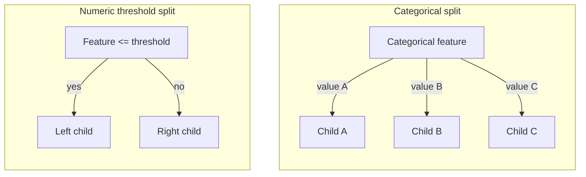
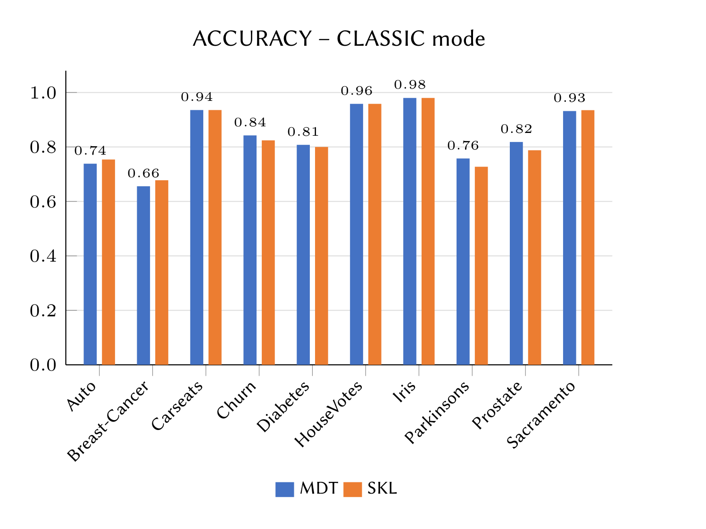
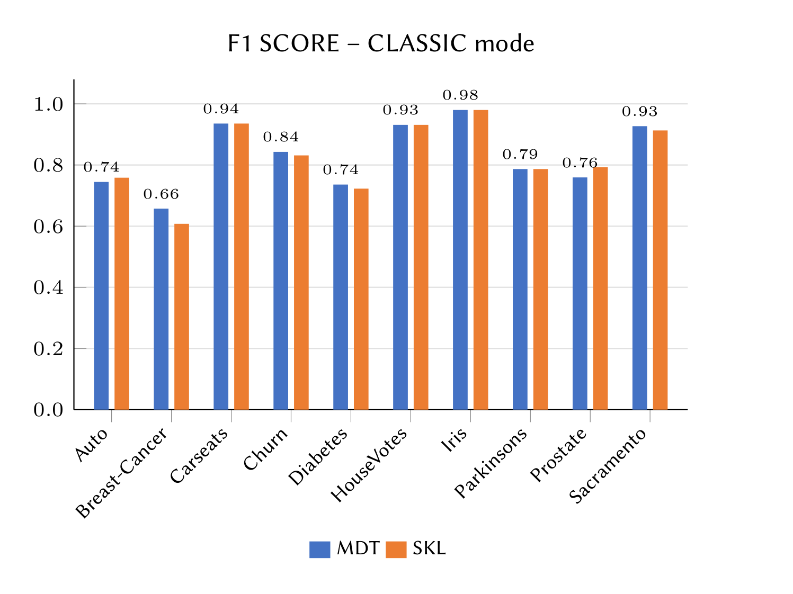

**Author:** Giuseppe Muschetta\
**University:** University of Pisa\
**Thesis:** Bachelor's thesis completed to earn my B.Sc. in Computer Science.\
**Degree:** B.Sc. in Computer Science\
**Supervisor:** Prof. Riccardo Guidotti\
**Academic year:** 2022/2023

<div align="center">

# MixedDecisionTree

**Native categorical features. Multiway splits. A decision tree built from first principles.**

A handwritten Python implementation that brings textbook decision trees to mixed tabular data, with three operating modes and a complete experimental comparison against scikit-learn.

**10 datasets · 3 operating modes · 2 impurity criteria · 51,840 archived evaluations**

[Read the thesis](REPORT.pdf) · [Quick start](#quick-start) · [Experimental results](#experimental-results) · [Explore the code](#repository-guide)

</div>

---

Original thesis title: *Implementazione Python di un Decision Tree Categorico Multi-Split*.

## Why this project exists

A categorical feature can have three, five, or twenty possible values. Why should its decision node always have only two branches?

MixedDecisionTree starts from that question. Its core is a recursive, ID3-style learning algorithm implemented directly in Python using pandas and NumPy. A categorical split creates **one branch per observed category**, preserving the vocabulary of the input data. Numerical features are handled through threshold expansion or discretization, depending on the selected mode.

The thesis investigates an explicit design trade-off: **readability, expressiveness, and flexibility**, alongside predictive performance and training cost. The reference implementation is scikit-learn's binary `DecisionTreeClassifier`, with categorical inputs encoded by the comparison scripts.

The project includes the learning algorithm, preprocessing strategies, experiment runners, saved results, tree exports, plotting tools, and a **75-page thesis** explaining the theory and implementation.

## How the tree learns

At each node, the algorithm evaluates candidate features and selects the split with the largest reduction in impurity:

```text
gain = impurity(parent) - weighted_mean(impurity(children))
```

Both **entropy** and **Gini impurity** are implemented. The tree grows recursively until a stopping or pre-pruning condition applies; terminal nodes receive a class label.



*Schematic of the supported split structures. Each child can become another decision node or a classification leaf.*

Key capabilities:

- **Native categorical branching:** string-valued features are used directly by the custom model, without one-hot encoding.
- **Mixed inputs:** categorical and numerical columns can coexist in the same dataframe.
- **Three numerical representations:** compare detailed threshold expansion with two discretization strategies.
- **Configurable pre-pruning:** limit depth, minimum samples for splitting, and minimum samples per child.
- **Inspectable predictions:** follow split conditions and class labels in the exported text trees.
- **An experimental workflow:** benchmark both models, save accuracy and weighted F1, and generate comparison plots from CSV results.

## Three operating modes

| Mode | Numerical features | Main trade-off |
| :--- | :--- | :--- |
| `classic` | Expands each distinct training value into a binary condition such as `PetalLengthCm <= 1.9`. | Fine-grained candidate thresholds; potentially large intermediate dataframes and higher training cost. |
| `median` | Applies `pandas.cut` to the training data, replaces intervals with their **midpoints**, then creates threshold conditions. | Fewer candidate thresholds; explores the balance between representation size and predictive performance. |
| `binned` | Converts numerical columns into interval categories, which can be split into multiple branches. | Avoids threshold expansion; performance depends on the discretization and dataset. |

Categorical columns retain their native branching behavior in all three modes. Set a positive `number_of_bins` for `median` and `binned`.

**Naming note:** `median` is the historical API name. The implementation uses interval **midpoints**, not statistical medians.

## Experimental results

The thesis compares MixedDecisionTree (**MDT**) with scikit-learn (**SKL**) across ten datasets, three modes, two impurity criteria, and multiple pre-pruning settings.

The following figures are **original images extracted from the thesis**. They show the `classic` comparisons under the dataset-specific configurations discussed in Chapter 4; their labels are preserved in Italian. Open either image for the full-resolution version.

| Accuracy | Weighted F1-score |
| :---: | :---: |
| [](docs/images/thesis-classic-accuracy.png) | [](docs/images/thesis-classic-f1.png) |

*Source: [REPORT.pdf](REPORT.pdf), printed pages 50 and 61. MDT is blue; SKL is orange. These configuration-specific figures are distinct from the independently selected peaks below.*

### What is preserved in this repository

The twenty CSV files in [`Results/`](Results/) contain **2,592 configurations per model per dataset**, for **51,840 recorded evaluations**. They store the mode, criterion, bin count, pruning parameters, accuracy, weighted F1, and fit time.

The table below was checked against those CSV files. Dataset dimensions describe the **local files shipped with the project**, which may differ from the full datasets commonly distributed under the same names. Every task uses the target column `class`.

**Scores are the highest archived holdout accuracy for each model, selected independently across all saved modes and settings.** They may come from different configurations and are exploratory results, rather than cross-validation estimates or an untouched final test.

| Dataset | Samples | Features | Classes | Best MDT accuracy | Best SKL accuracy |
| :--- | ---: | ---: | ---: | ---: | ---: |
| Auto | 392 | 7 | 3 | 80.00% | 82.31% |
| breast-cancer | 271 | 8 | 2 | 66.67% | 74.44% |
| Carseats | 279 | 10 | 2 | 93.55% | 93.55% |
| churn | 500 | 13 | 2 | 84.85% | 85.45% |
| diabetes | 393 | 8 | 2 | 83.08% | 82.31% |
| HouseVotes84 | 434 | 16 | 2 | 95.83% | 95.83% |
| Iris | 150 | 4 | 3 | 100.00% | 100.00% |
| parkinsons | 100 | 22 | 2 | 90.91% | 87.88% |
| prostate | 97 | 7 | 2 | 90.91% | 90.91% |
| Sacramento | 932 | 6 | 3 | 94.16% | 95.13% |

The custom model reaches comparable peak accuracy on several datasets and higher archived peaks on diabetes and parkinsons. The thesis also records the substantial training-time advantage of scikit-learn. The value of MDT is the combination of explicit algorithm design, native categorical structure, and an inspectable comparison of alternative representations.

### Evaluation protocol

- **Split:** stratified holdout, `test_size=0.33`, `random_state=43`.
- **Metrics:** accuracy and F1 with `average="weighted"`.
- **Criteria:** `entropy`, `gini`.
- **Depths:** `2, 3, 4, 5, 6, 7, 8, 25, 50`.
- **Minimum split sizes:** `2, 3, 5, 10, 25, 50`.
- **Minimum leaf sizes:** candidates `1, 3, 5, 10, 25, 50`; the scripts retain only pairs satisfying `min_samples_split > min_samples_leaf`, so leaf size `50` is never evaluated.
- **Bin counts:** `20, 15, 11, 7` for `median` and `binned`; `classic` records `Bins=0`.
- **Timing:** `ELAPSED_TIME_MS` measures `fit`, excluding preprocessing, prediction, and metric computation.

The saved configurations are complete and identical across each MDT/SKL dataset pair. See [reproducibility notes](#reproducibility-notes) for the limits of the original evaluation design.

## Quick start

Run commands from the project root. A virtual environment keeps the dependencies separate:

```bash
python3 -m venv .venv
source .venv/bin/activate
python -m pip install numpy pandas scikit-learn matplotlib
```

On Windows, activate with `.venv\Scripts\activate`.

### Train and evaluate on Iris

Run this example in a Python session or save it as a separate script in the project root:

```python
import pandas as pd
from sklearn.metrics import accuracy_score, f1_score

from MixedDecisionTree import MixedDecisionTree

data = pd.read_csv("Datasets/Iris.csv", skipinitialspace=True)

tree = MixedDecisionTree(
    class_name="class",
    tree_mode="classic",
    criterion="entropy",
    max_allowed_depth=5,
    min_samples_split=2,
    min_samples_leaf=1,
)

X_train, X_test, y_train, y_test = tree.select_tree_modes(
    data.copy(deep=True)
)

tree.fit(X_train.copy(deep=True), y_train)
predictions = tree.predict(X_test.copy(deep=True), y_test)

print(f"Accuracy: {accuracy_score(y_test, predictions):.3f}")
print(
    f"Weighted F1: "
    f"{f1_score(y_test, predictions, average='weighted'):.3f}"
)
```

Verified output for this configuration:

```text
Accuracy: 0.960
Weighted F1: 0.960
```

This example and all six mode/criterion combinations on Iris were smoke-tested with Python **3.14.6**, NumPy **2.4.6**, pandas **3.0.3**, and scikit-learn **1.9.0**. These checks confirm basic execution; the complete historical benchmark was not rerun.

The original thesis documents NumPy **1.21.5**, pandas **1.4.4**, scikit-learn **1.1.1**, and Matplotlib **3.5.2**.

### Try another representation

Replace the constructor above with one of these, then repeat preparation, training, and prediction:

```python
# Midpoint-based threshold expansion
tree = MixedDecisionTree(tree_mode="median", number_of_bins=20)

# Multiway splits over discretized numeric intervals
tree = MixedDecisionTree(tree_mode="binned", number_of_bins=11)
```

### Inspect a trained tree

```python
with open("my_tree.txt", "w", encoding="utf-8") as output:
    tree.displayDT(tree.root, output, width=3)
```

This writes `my_tree.txt` and also prints the tree to the console. Existing examples are available in [`Visual_mixedDT/`](Visual_mixedDT/).

## API and configuration

| Parameter | Default | Purpose |
| :--- | :--- | :--- |
| `class_name` | `"class"` | Target column in the input dataframe. |
| `tree_mode` | `"classic"` | `classic`, `median`, or `binned`. |
| `criterion` | `"entropy"` | Entropy or Gini impurity. |
| `max_allowed_depth` | `50` | Maximum tree depth, with the root at depth zero. |
| `min_samples_split` | `2` | Minimum number of samples required to split a node. |
| `min_samples_leaf` | `1` | Minimum permitted child size; if any child of the selected split is too small, the current node becomes a leaf. |
| `number_of_bins` | `0` | Set a positive integer for `median` or `binned`; ignored in `classic`. |
| `cut_threshold` | `10000` | In `classic`, retain only the first rows up to this limit. |

The workflow is `select_tree_modes(dataframe)` → `fit(X_train, y_train)` → `predict(X_test, y_test)`. Preparation initializes the training-majority fallback used for unseen categories.

The API follows the original academic implementation: `fit` returns the root node, and `predict` requires `y_test`. Prediction appends the supplied labels to its input dataframe and excludes that column when traversing the tree. This is a custom class with its own interface, rather than a scikit-learn estimator.

Preparation, training, and prediction can modify their input dataframes. The quick-start example passes copies to preserve the caller's data. Represent categorical features as strings; integer and floating-point feature columns are treated as numerical. Clean missing values before training.

## Repository guide

```text
.
├── MixedDecisionTree.py     # Custom learner, preprocessing modes, text export, demo
├── MDT_verify.py            # Hyperparameter experiments for the custom model
├── SKLEARN_verify.py        # Reference experiments and binary tree visualization
├── Output.py               # Per-model tables and plots from saved results
├── Overlaps_ACC.py         # Overlaid accuracy curves for both models
├── Overlaps_F1.py          # Overlaid weighted F1 curves for both models
├── Datasets/               # 10 local classification datasets
├── Results/                # 20 archived experiment CSV files
├── Visual_mixedDT/         # 10 custom-model text trees
├── Visual_sklearn/         # 10 reference tree PNGs and 10 text logs
├── docs/images/            # Selected original thesis figures used here
└── REPORT.pdf              # Full thesis, in Italian
```

Suggested reading path: start with [`MixedDecisionTree.py`](MixedDecisionTree.py), follow the experiment runners, then inspect the saved results and Chapter 4 of the [thesis](REPORT.pdf).

<details>
<summary><strong>See an exported reference tree</strong></summary>


This is the **scikit-learn binary reference tree** on Iris. The custom model's own outputs are text trees; inspect [Iris](Visual_mixedDT/Iris_entropy_mixed_textTREE.txt) for numerical thresholds and [Sacramento](Visual_mixedDT/Sacramento_entropy_mixed_textTREE.txt) for a native categorical `zip` root with multiple branches.

</details>

## Running the original scripts

The scripts use settings inside their source files, rather than command-line arguments. All paths are relative to the project root. Work on a copy when preserving the archived experiments, because runners and plotters write output files.

| Script | Configuration and behavior |
| :--- | :--- |
| `MixedDecisionTree.py` | Edit `settings()` to select a dataset and parameters. The current demo uses `prostate.csv`, `classic`, and `entropy`, then writes a text tree and scores. |
| `MDT_verify.py` | Set `file_name` in `main()` to an included dataset such as `Iris.csv`. The current value, `ChickWeight.csv`, is absent from this snapshot. Running the grid replaces that dataset's MDT result CSV. |
| `SKLEARN_verify.py` | Set `file_name` in `main()` to the same dataset. Its current value is `Auto.csv`. Replaces the SKL result CSV and the dataset's reference tree exports. |
| `Output.py` | Set `tables=True` and/or `graphs=True` in `main()`; both default to `False`. Creates `Tables/` and/or `Graphs/`. Table output is appended, so repeated runs can duplicate rows. |
| `Overlaps_ACC.py` | Reads the archived results and writes comparison plots under `Overlaps_accuracy/`. |
| `Overlaps_F1.py` | Reads the archived results and writes comparison plots under `Overlaps_F1_score/`. |

After configuring the relevant script:

```bash
python MixedDecisionTree.py

# Rerun experiments only when you intend to replace the corresponding CSVs:
python MDT_verify.py
python SKLEARN_verify.py

# Generate comparison figures from the saved CSVs, without retraining:
python Overlaps_ACC.py
python Overlaps_F1.py
```

The demo refers to `visual_mixedDT/`, while the distributed folder is `Visual_mixedDT/`. On a case-sensitive filesystem, align the demo's output path with the actual folder name before running it. The import-based quick-start example does not depend on that export path.

The original plotting grids can generate thousands of files; narrow their dataset and parameter lists for a focused inspection.

## Reproducibility notes

The project preserves an academic experiment and its original design decisions. A few details matter when interpreting or extending it:

- **Repeated use of one holdout:** parameter configurations are evaluated on the same test split, with no separate validation set or cross-validation. Selecting the highest test score can produce optimistic estimates. For Iris, the test set contains only 50 samples.
- **Preprocessing scope:** MDT `binned` and the reference `median`/`binned` pipelines derive intervals from the full dataframe before splitting; the reference also encodes categorical features before splitting. For a new generalization study, learn preprocessing on training data and evaluate on an untouched test set.
- **Baseline randomness:** the data split is seeded, but the reference `DecisionTreeClassifier` does not set its own `random_state`.
- **Timing scope:** recorded times describe model fitting, rather than the complete pipeline. Threshold expansion can itself require substantial time and memory.
- **Historical snapshots:** tree exports and thesis figures are preserved examples and may reflect earlier data or parameter settings. The results table in this README uses the distributed CSVs as its source.
- **Representation choices:** `median` trains on interval midpoints and predicts against original numerical test values. Unseen categorical branches fall back to the global training-majority class.

These details make the repository a useful starting point for studying multiway induction, inspecting implementation choices, and designing a more rigorous follow-up evaluation.

## Thesis and authorship

**Giuseppe Muschetta** · Bachelor's degree in Computer Science · **University of Pisa**  
Supervisor: **Prof. Riccardo Guidotti** · Academic year **2022/2023**

The [full thesis](REPORT.pdf) covers decision-tree foundations, Hunt's algorithm, impurity measures, the Python implementation, all three modes, experiments, conclusions, and bibliography. The original model and experimental code were developed by the author as part of this thesis.

If you reference this work in a report or presentation, please credit the author and thesis title above. No `LICENSE` file is included in this repository snapshot.
